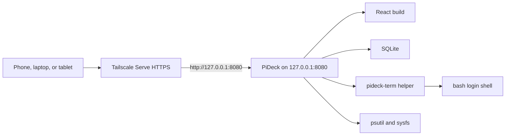

# PiDeck

PiDeck is a small web control center for a Raspberry Pi. It shows live CPU, memory, storage, network, and power stats, and it opens a real shell in the browser. You develop it on a laptop, push it to GitHub, and run it on the Pi as one local service.

The service binds to `127.0.0.1:8080` only. Tailscale Serve publishes it on your tailnet over HTTPS. It is not exposed to the public internet, and it does not use Tailscale Funnel. Tailscale decides who can open the site. PiDeck still asks for its own username and password.

## Screenshots

Screenshots belong here after the first run on the Pi:

- `docs/screenshots/dashboard.png`
- `docs/screenshots/terminal.png`
- `docs/screenshots/settings.png`

## Architecture



One Python process serves the API and the built frontend. It runs as the unprivileged `pideck` account. The browser terminal is a second process, `pideck-terminal.service`, running as `pideck-term`. Node is only needed while building the UI. Tailscale Serve still proxies HTTPS to `127.0.0.1:8080`.

## Features

- Live system snapshot about every 2 seconds: CPU, per-core load, temperature, frequency, load average, memory, storage, network, uptime, OS, and Raspberry Pi model when Linux exposes it
- PiSugar S Plus charge timing is an estimate from external-power detection and a calibrated runtime. It is labeled estimated charge, not a fuel-gauge percentage. A sysfs or psutil battery is still shown when that hardware exists and the PiSugar pin cannot be read
- Browser terminal backed by a Linux PTY in the `pideck-term` account, with resize, ANSI color, and the normal shell behavior for programs such as `htop`, `nano`, and `vim`
- Local users in SQLite, Argon2id password hashes, and HttpOnly session cookies
- Blue, Hacker Green, Purple, Red, and custom themes stored on the user and in the browser
- systemd unit and install, update, and uninstall scripts
- No Docker and no default password

## PiSugar S Plus

The S Plus 5000 mAh pack cannot report a real percentage. PiDeck estimates when to charge from how long the Pi has been unplugged.

The [PiSugar S series documentation](https://docs.pisugar.com/docs/product-wiki/battery/pisugar-s-series) says that, with the auto-start switch on, GPIO3 (SCL) is low while external power is connected and high when it is not. That is a pin level, not an I2C register. The same page says this cannot be used together with I2C, because SCL stays low while external power is present. PiDeck does not read PiSugar 2/3 battery registers.

PiDeck reads the pin with `gpioget` from the `gpiod` package, which uses the GPIO character device. It does not use `/sys/class/gpio`. If I2C is enabled, or the pin cannot be read, the reading is `external_power: null`. PiDeck does not invent a power state.

On the Pi:

1. Switch on PiSugar auto-start. Leave I2C off. `dtparam=i2c_arm=on` must not be set, and `/dev/i2c-1` must not be present.
2. Install the GPIO tools: `sudo apt install gpiod`
3. If `gpioget` says permission denied, add the PiDeck user to the `gpio` group and start a new login: `sudo usermod -aG gpio USER`
4. In Settings, set **Full runtime** to a measured battery run, in minutes. `300` means 5 hours.
5. Set **Full charge time** to how long external power must stay connected before the estimate resets to 100%. PiSugar does not publish a charge time for this S Plus pack, so leave it empty until you measure one. A shorter plug-in stays **Charge estimate uncertain**.

The card uses these bands: above 40% normal, 20–40% low, 10–20% charge soon, below 10% critical. The colors come from the theme accent, warning, and danger variables.

A discharge that starts after a completed full-charge time and ends because the Pi loses power is stored as a calibration sample. The runtime used for estimates is the median of the last five samples. One new sample can move that saved runtime by at most 25%. The custom button shares GPIO3, so a press can look like a power change while auto-start is on.

## Repository layout

```text
backend/          FastAPI app, auth, monitoring, PTY terminal, tests
frontend/         React + Vite + TypeScript + xterm.js
scripts/          install.sh, update.sh, uninstall.sh
systemd/          pideck.service template
data/             SQLite database at runtime (not committed)
.env.example      configuration template
```

## Development on Windows

Use two terminals from the repository root.

Python:

```powershell
py -m venv backend\.venv
.\backend\.venv\Scripts\Activate.ps1
pip install -r backend\requirements.txt
pip install -r backend\requirements-dev.txt
Copy-Item .env.example .env
python -c "import secrets; print(secrets.token_urlsafe(48))"
```

Put that secret in `.env` as `PIDECK_SESSION_SECRET`. For day-to-day UI work you can instead set `PIDECK_DEV=true` and leave the example placeholder; PiDeck will use a temporary secret and warn you. Do not do that on the Pi.

```powershell
$env:PIDECK_DEV = "true"
python -m backend
```

The API listens on `http://127.0.0.1:8080`.

Create the first user in another terminal, with the virtual environment active and the repository root as the working directory:

```powershell
python -m backend.create_user
```

Frontend:

```powershell
cd frontend
npm install
npm run dev
```

Open `http://127.0.0.1:5173`. Vite proxies `/api` and `/ws` to FastAPI.

The Windows terminal page is a development fallback. It is not a PTY, so full-screen programs will not behave like they do on the Pi. On a Linux laptop, `PIDECK_DEV=true` opens a local PTY only when `/run/pideck/terminal.sock` is absent. Production refuses that fallback.

Useful checks:

```powershell
pytest
cd frontend
npm run typecheck
npm run build
```

`uvicorn backend.main:app --reload --host 127.0.0.1 --port 8080` also works from the repository root. Prefer `python -m backend`, which refuses a public bind address.

## Development on Linux

From the repository root:

```bash
python3 -m venv backend/.venv
source backend/.venv/bin/activate
pip install -r backend/requirements.txt
pip install -r backend/requirements-dev.txt
cp .env.example .env
python -c "import secrets; print(secrets.token_urlsafe(48))"
```

Edit `.env`, set `PIDECK_DEV=true` while you are working locally, then:

```bash
python -m backend
```

In another terminal:

```bash
python -m backend.create_user
cd frontend
npm install
npm run dev
```

Run `pytest` from the repository root.

## Raspberry Pi installation

On the Pi, as the normal user that should own the dashboard (not root):

```bash
git clone https://github.com/YOUR_USER/pideck.git
cd pideck
chmod +x scripts/*.sh
./scripts/install.sh
```

The installer:

1. Checks that it is Linux and that it is not running as root
2. Asks before installing missing `python3`, `venv`, `nodejs`, or `npm` packages
3. Creates `backend/.venv` and installs Python dependencies
4. Installs frontend dependencies and builds the UI
5. Writes `.env` with a random session secret if `.env` does not exist
6. Prompts for the first username and password if the database has no users
7. Installs and starts `pideck.service` with sudo
8. Prints the Tailscale Serve commands for you to run yourself

Python 3.11+ and Node.js 18+ are required. If `pip` fails on 32-bit Raspberry Pi OS because a wheel is missing:

```bash
sudo apt-get install -y build-essential python3-dev libffi-dev
./scripts/install.sh
```

A Raspberry Pi 3B+ with 1 GB of RAM can run out of memory while Vite builds. If `npm run build` is killed, add swap and run `./scripts/update.sh` again.

PiDeck does not install or configure Tailscale for you.

## First user

There is no default password. On the Pi, run this as `pideck` so the database stays owned by the service account:

```bash
sudo -u pideck --chdir /home/admin/RasberryPI-Dashboard backend/.venv/bin/python -m backend.create_user
```

During laptop development, from the repository root with the virtual environment's Python:

```bash
backend/.venv/bin/python -m backend.create_user
```

The command asks for a username and a password (minimum 10 characters). Passwords are stored as Argon2id hashes.

Add another account later:

```bash
backend/.venv/bin/python -m backend.create_user --add
```

Avoid `--password` when you can. It shows up in the process list. A prompt, or the `PIDECK_SETUP_PASSWORD` environment variable, is safer.

## systemd

`scripts/install.sh` and `scripts/migrate-privileges.sh` render the units with absolute paths, copy them to `/etc/systemd/system/`, and start them.

`pideck.service` runs as `pideck`, with the repository as its working directory:

```bash
backend/.venv/bin/python -m backend
```

That command reads `.env` and the systemd credential `session_secret`. It binds `PIDECK_HOST` / `PIDECK_PORT`, which default to `127.0.0.1:8080`. The app exits if the host is not localhost unless `PIDECK_ALLOW_NON_LOCALHOST=true`. Leave that flag false.

The unit sets `NoNewPrivileges=yes`, `ProtectSystem=strict`, `PrivateTmp=yes`, and `ReadWritePaths` to the checkout's `data/` directory. `SupplementaryGroups=gpio` is there for PiSugar's `gpioget`. The service does not get a sudo rule.

`pideck-terminal.service` runs as `pideck-term` and listens on `/run/pideck/terminal.sock` (`root:pideck`, mode `0660`). It execs `/bin/bash --login -i` and nothing else. `NoNewPrivileges=yes` blocks setuid helpers such as sudo from that shell.

```bash
systemctl status pideck pideck-terminal
journalctl -u pideck -n 100 --no-pager
sudo systemctl restart pideck-terminal.socket pideck-terminal.service
sudo systemctl restart pideck
```

Do not restart Tailscale, NetworkManager, hostapd, dnsmasq, nftables, or Pi-hole as part of a PiDeck restart. Tailscale Serve keeps forwarding to `127.0.0.1:8080`.

## Tailscale

Install Tailscale using Tailscale's own instructions and join the Pi to your tailnet. Then:

```bash
sudo tailscale serve --bg 8080
tailscale serve status
```

`tailscale serve --bg 8080` keeps an HTTPS proxy on the tailnet pointed at `http://127.0.0.1:8080`. It survives reboot. Do not run `tailscale funnel`. Funnel would publish the Pi beyond your tailnet.

Your tailnet ACL still applies. PiDeck's login is a second check, and it stays on.

Disable this proxy:

```bash
sudo tailscale serve --bg 8080 off
tailscale serve status
```

`tailscale serve reset` deletes every Serve handler on the Pi, including ones that are not PiDeck. Use it only when that is what you want.

### Cookies behind Tailscale

Tailscale terminates HTTPS and forwards HTTP to localhost. `PIDECK_COOKIE_SECURE=auto` marks the session cookie `Secure` when `X-Forwarded-Proto` is `https`, which Serve sends. The cookie is HttpOnly and `SameSite=Lax`.

Use `PIDECK_COOKIE_SECURE=false` only for plain `http://127.0.0.1` during development. If a Tailscale login succeeds and the browser immediately forgets it, set `PIDECK_COOKIE_SECURE=true` in `.env` and restart the service.

Changing requests must come from the same host. That blocks a random website from posting to PiDeck with your cookie.

## Hotspot HTTPS

Tailscale Serve stays pointed at `http://127.0.0.1:8080`. A second path serves the same app on the CYBERDECK hotspot at `https://10.42.0.1:8443`.

Caddy is the local proxy. It terminates TLS, forwards WebSocket upgrades, and can listen on one address. The dashboard process is unchanged, so login, themes, and the terminal use the same cookies and origin checks. `PIDECK_COOKIE_SECURE=auto` marks the cookie Secure when Caddy sends `X-Forwarded-Proto: https`. The browser Host is left as `10.42.0.1:8443`, which is what the origin check compares.

The Debian `caddy` package also ships `caddy.service`, which listens on port 80. Pi-hole already uses that port. `install-local-https.sh` disables `caddy.service` and starts `pideck-local.service` instead. That unit binds only `10.42.0.1:8443`. It does not listen on port 53, port 80, `0.0.0.0`, or the upstream Wi-Fi address. It does not change hotspot, DHCP, NAT, or Tailscale settings.

The certificate is a private CA stored on the Pi. Phones trust `ca.crt` once. After that, the hotspot site works with no upstream Wi-Fi, no public DNS, and no Tailscale. The leaf certificate lasts 825 days. Renewal keeps the same CA.

On the Pi, as `admin`, after this revision is checked out:

```bash
sudo apt-get install caddy
./scripts/install-local-https.sh
```

Run those together. The package may start `caddy.service` on port 80 until the installer disables it. The installer does not restart `pideck.service`.

Copy the CA to the phone while you still have another path to the Pi, such as SSH or Tailscale. Do not accept the browser warning instead of installing the CA.

```bash
sudo cp /var/lib/pideck-local/ca.crt /tmp/pideck-cyberdeck-ca.crt
sudo chmod 644 /tmp/pideck-cyberdeck-ca.crt
```

Transfer `pideck-cyberdeck-ca.crt` to the phone, then:

- iPhone: open the file, install the profile, then enable it under Settings, General, About, Certificate Trust Settings.
- Android: Settings, Security, Encryption and credentials, Install a certificate, CA certificate.

Join the CYBERDECK Wi-Fi, turn off mobile data, and open `https://10.42.0.1:8443`. Log in, open the terminal, and log out. The terminal socket is `wss://10.42.0.1:8443/ws/terminal`. Repeat login and the terminal at `https://cyberdeckv2.tail1eaaa2.ts.net` from a tailnet client. The two cookies are separate because the host names differ.

Confirm the listener and that a proxy failure leaves Tailscale's target up:

```bash
ss -ltn 'sport = :8443'
systemctl is-active pideck.service pideck-local.service
curl -fsS --cacert /var/lib/pideck-local/ca.crt https://10.42.0.1:8443/api/health
curl -fsS http://127.0.0.1:8080/api/health
sudo systemctl stop pideck-local.service
curl -fsS http://127.0.0.1:8080/api/health
sudo systemctl start pideck-local.service
tailscale serve status
```

`ss` must show `10.42.0.1:8443` and must not show `0.0.0.0:8443`. From a device on the upstream Wi-Fi, `https://10.42.0.1:8443` and port 8443 on the Pi's upstream address should both fail.

Later deploys use `./scripts/update.sh`. If the proxy unit is already installed, that script copies the Caddyfile and restarts only `pideck-local.service`. If that restart fails, `pideck.service` is left running.

Remove the hotspot path:

```bash
./scripts/rollback-local-https.sh --confirm-remove-local-proxy
```

This stops and removes `pideck-local.service` and `/etc/pideck/Caddyfile`. It does not restart PiDeck, enable the packaged `caddy.service`, or delete `/var/lib/pideck-local`. Delete that directory yourself only when you also want phones to stop trusting the CA.

## GitHub deploy and update

On the laptop:

```bash
git add .
git commit -m "Describe the change"
git push
```

On the Pi, from the clone:

```bash
./scripts/update.sh
```

`update.sh` fast-forwards git, installs Python requirements, rebuilds the frontend, restarts `pideck.service`, and prints whether the restart succeeded.

It does not delete the database or rewrite user rows. Startup only runs `CREATE TABLE IF NOT EXISTS`.

## Themes

Open Settings. Pick Blue, Hacker Green, Purple, or Red, or change the color pickers. The preview card updates immediately. Save stores the theme on the signed-in user. The browser also keeps a copy in `localStorage` so the login page can use it.

Reset to default saves the Blue theme. Colors are `#RRGGBB` only.

Every screen reads the same CSS variables: `--primary`, `--secondary`, `--accent`, `--background`, `--panel`, and `--text`.

## Terminal security

The browser shell is `pideck-term`, not the dashboard user and not root. `pideck-term` has no sudo rule. The dashboard account `pideck` has no sudo rule either. The only privileged step on the Pi is `admin` using its own sudo to install units and to create those system users.

Protections:

- The WebSocket checks the session cookie and the `Origin` header before it connects to the helper
- The helper socket is mode `0660` and group `pideck`, so other accounts cannot connect
- The helper execs a fixed `bash --login -i`. It does not accept a command, a user, or an environment from the client
- Anonymous sockets are closed and do not start a shell
- There is no `/api/run?command=` endpoint
- API code does not pass browser strings into shell commands. Tailscale probes use a fixed argument list
- At most four terminal sessions in the dashboard and four in the helper
- The helper starts with `HOME`, `USER`, `LOGNAME`, `SHELL`, `PATH`, `TERM`, `COLORTERM`, and `LANG` only
- Production removes `PIDECK_SESSION_SECRET` from the dashboard environment when the systemd credential is present
- The session secret file is `/etc/pideck/session.secret`, mode `600`, owner `root`. The database directory is mode `750`, owner `pideck`
- In production, a missing helper socket does not fall back to a shell as `pideck`
- The server refuses to listen on `0.0.0.0` unless you explicitly override that safety check

Anyone who can log in to PiDeck can do whatever `pideck-term` can do. That account cannot read `.env`, the session secret, or `data/pideck.db`.

## Configuration

Copy `.env.example` to `.env`. Never commit `.env`.

| Variable | Purpose |
| --- | --- |
| `PIDECK_HOST` | Bind address. Keep `127.0.0.1` |
| `PIDECK_PORT` | Bind port. Default `8080` |
| `PIDECK_DATABASE` | SQLite file. Default `./data/pideck.db` |
| `PIDECK_SESSION_SECRET` | Development HMAC key. On the Pi, leave this unset and use `/etc/pideck/session.secret` |
| `PIDECK_SESSION_HOURS` | Session lifetime, 1 to 168. Default 24 |
| `PIDECK_COOKIE_SECURE` | `auto`, `true`, or `false` |
| `PIDECK_DEV` | `true` on a laptop, `false` on the Pi |
| `PIDECK_ALLOW_NON_LOCALHOST` | Leave `false` |
| `PIDECK_TERMINAL_SOCKET` | Helper socket. Default `/run/pideck/terminal.sock` |

Generate a secret:

```bash
python -c "import secrets; print(secrets.token_urlsafe(48))"
```

## Move an existing Pi off root

Run this on the Pi as `admin`, from `/home/admin/RasberryPI-Dashboard`, after this revision is checked out. Do not run it as root. It does not pull git, delete SQLite, rotate a credential that already exists, or restart Tailscale, NetworkManager, hostapd, dnsmasq, nftables, or Pi-hole.

```bash
chmod +x scripts/*.sh
./scripts/migrate-privileges.sh
```

The script saves `/etc/systemd/system/pideck.service` and `.env` under `/var/backups/pideck/` the first time, creates `pideck` and `pideck-term` if they are missing, and grants those accounts execute-only access on parent directories that are not already world-executable. It uses `setfacl` and does not change home-directory mode bits. If the `acl` package is missing, it stops before moving the secret or restarting anything. It then moves `PIDECK_SESSION_SECRET` into `/etc/pideck/session.secret` when that file is empty, stops only `pideck.service`, and sets `pideck:pideck` ownership with mode `0600` on the configured SQLite file and its `-wal` and `-shm` siblings. It installs both units and restarts only those units. The terminal helper keeps its working directory at `/var/lib/pideck-term` and finds the checkout through `PYTHONPATH`.

Check:

```bash
systemctl is-active pideck.service pideck-terminal.service
curl -fsS http://127.0.0.1:8080/api/health
ps -o user= -p "$(systemctl show -p MainPID --value pideck.service)"
tailscale serve status
```

The dashboard user must be `pideck`. A browser terminal session must report `pideck-term`.

Later updates:

```bash
./scripts/update.sh
```

`update.sh` refuses to run as root. If the credential file or the system users are missing, it builds the tree and leaves the running unit alone.

Rollback, if the new service does not come up:

```bash
./scripts/rollback-privileges.sh --confirm-restore-previous-unit
```

That restores the backed-up unit and `.env`. It stops the terminal helper and restarts `pideck.service` only. It does not delete users, the database, or `/etc/pideck/session.secret`. If the checkout still has this terminal code, also check out the previous Git commit before expecting the old in-process shell. The restored unit may run as root. That is the previous production state, not the steady state.

## Troubleshooting

**`Unit pideck.service has a bad unit file setting`.** `StartLimitIntervalSec=` and `StartLimitBurst=` belong under `[Unit]`. Run `./scripts/update.sh` so it rewrites `/etc/systemd/system/pideck.service` from the template.

**`path is not absolute`.** systemd is still using a placeholder or a quoted path. Do not copy `systemd/pideck.service` into `/etc` by hand. From the PiDeck directory run `./scripts/update.sh`. It fills in the real absolute path, reloads systemd, and restarts PiDeck.

**The service restarts and then stops.** `journalctl -u pideck -n 80 --no-pager`. The usual causes are a missing `.env`, a missing `/etc/pideck/session.secret` while `PIDECK_DEV=false`, a missing `gpio` group, or `PIDECK_HOST` set to something other than localhost.

**Login always says the password is wrong.** Create a user with `python -m backend.create_user`. The message is the same when the username does not exist.

**Login works on the Pi's localhost but not through Tailscale.** Check `tailscale serve status`. Then try `PIDECK_COOKIE_SECURE=true`.

**The browser says the frontend is not built.** On the Pi, `cd frontend && npm run build`, or run `./scripts/update.sh`. During laptop development, use `npm run dev` instead of port 8080 for the UI.

**The terminal disconnects immediately.** You are not logged in, the origin does not match, four sessions are already open, or `pideck-terminal.service` is down. On Windows this page is only a pipe-backed shell.

**Battery says information is unavailable.** The Pi has no battery interface in sysfs and psutil did not report one. For a PiSugar S Plus, the card instead needs `gpiod`, auto-start switched on, and I2C left off. See [PiSugar S Plus](#pisugar-s-plus).

**CPU temperature is unavailable.** This host has no `/sys/class/thermal/thermal_zone0/temp` reading and no psutil temperature sensor. The rest of the dashboard still works.

**`npm run build` dies on a Pi 3.** Add swap. The running app does not need Node after the build.

**`.env` was edited on Windows and the service will not start.** Convert it to Unix line endings. A trailing carriage return can sneak into the host or secret.

## Uninstall

On the Pi:

```bash
./scripts/uninstall.sh
```

That disables and deletes `pideck.service` only. It leaves the git checkout, virtual environment, `.env`, and database. The script prints the commands to delete those files and to turn off Tailscale Serve.

PiDeck will not run `tailscale serve reset` for you.

## Tests

From the repository root, with the dev requirements installed:

```bash
pytest
```

The tests cover login, generic auth failures, rate limiting, protected routes, settings validation, the system snapshot, static path checks, terminal WebSocket authentication, root-unit rejection, credential handling, and the terminal helper protocol. They use a temporary database. POSIX permission bits and a live Linux PTY are skipped on Windows.

## License

MIT. See [LICENSE](LICENSE).
